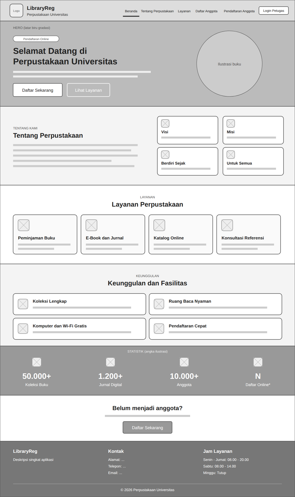
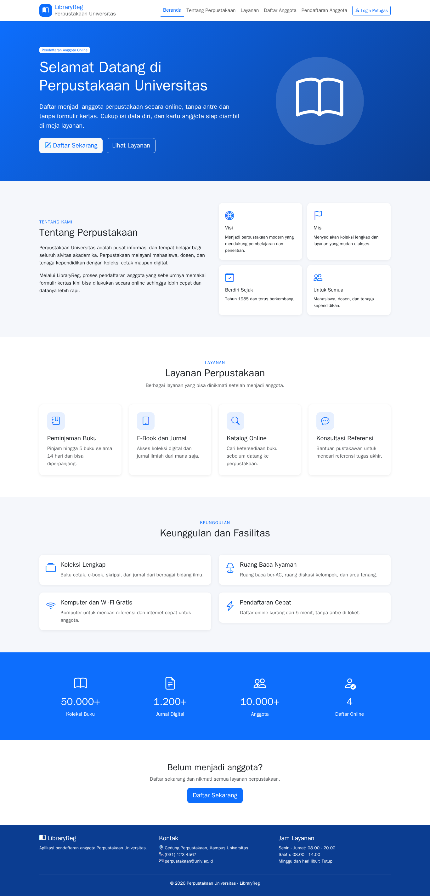
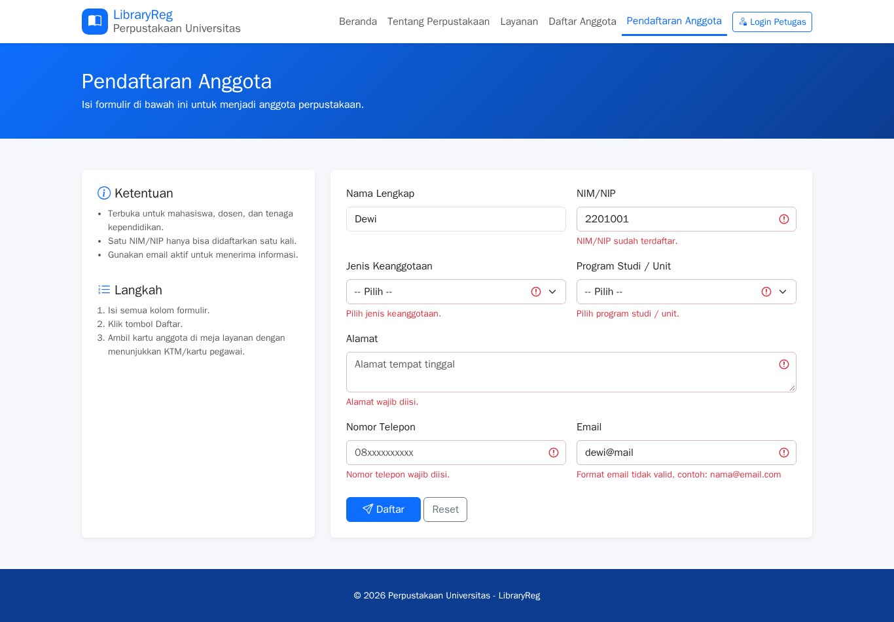
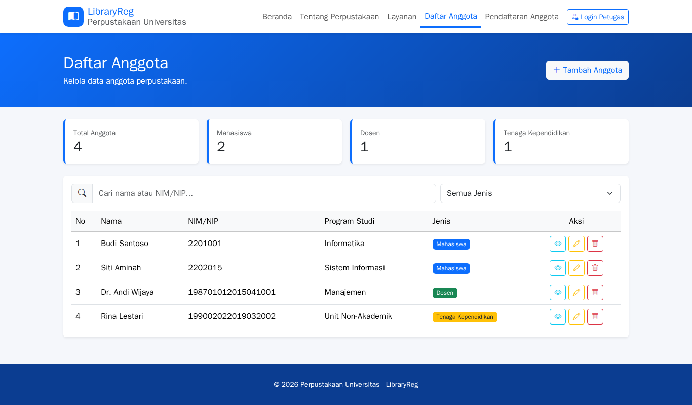
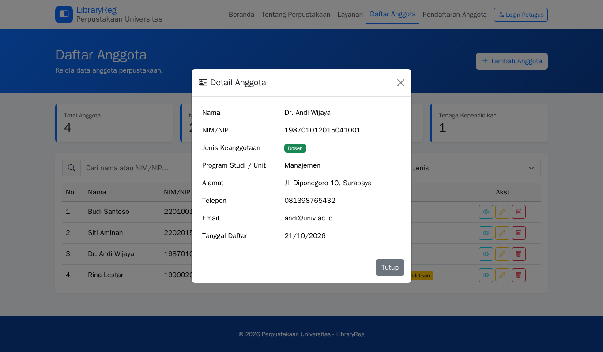
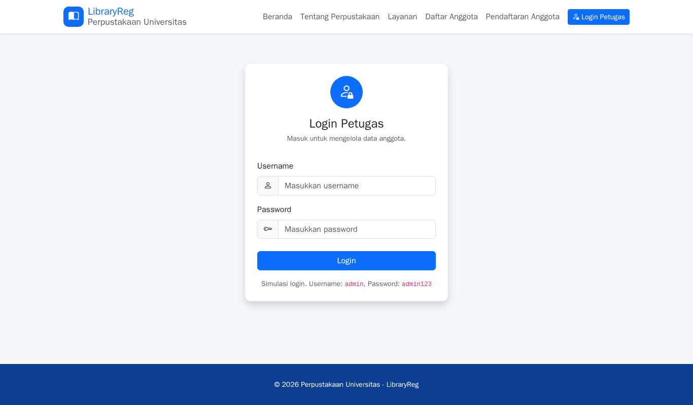

# LibraryReg — Aplikasi Pendaftaran Anggota Perpustakaan

Evaluasi [Studi Kasus - Perpustakaan](https://fajarbaskoro.blogspot.com/2026/10/studi-kasus-perpustakaan.html), dibuat dengan HTML, Bootstrap 5, Bootstrap Icons, dan JavaScript. Data disimpan di localStorage.

- Website: https://jojoevan.github.io/web-programming/evaluasi-studi-kasus-perpustakaan/

## Struktur File

```
index.html         Beranda
pendaftaran.html   Formulir pendaftaran
pendaftaran.js
anggota.html       Daftar anggota (ringkasan, cari, filter, detail, edit, hapus)
anggota.js
login.html         Login petugas (simulasi, admin / admin123)
app.js             Fungsi bersama: data, validasi, notifikasi
style.css
wireframe/         Wireframe landing page
screenshots/       Screenshot hasil akhir
```

## Wireframe



## Screenshot

| Beranda | Pendaftaran (validasi) |
|---|---|
|  |  |

| Daftar Anggota | Detail Anggota |
|---|---|
|  |  |

| Login Petugas |
|---|
|  |
