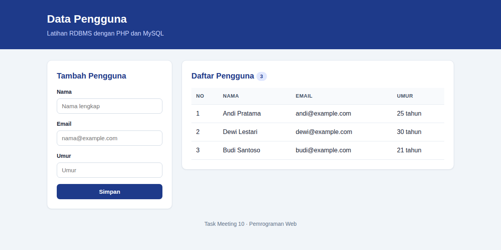
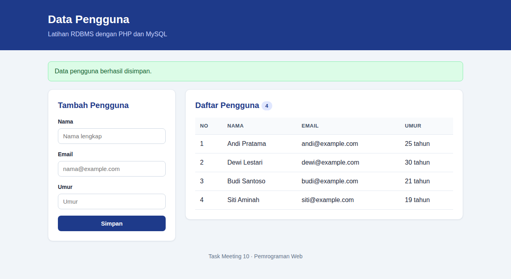
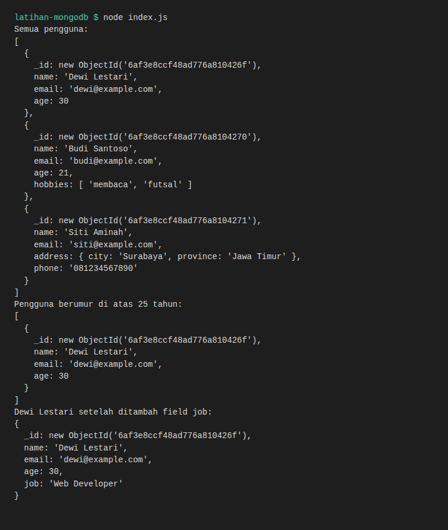

# Latihan Database: RDBMS, MongoDB, dan Spesifikasi Proyek

Tugas ini mengerjakan latihan dari materi [PWeb: Penggunaan dan Pemilihan Database untuk Back End](https://fajarbaskoro.blogspot.com/2018/04/pweb-mysql.html).

| Latihan | Hasil |
|---|---|
| Aplikasi sederhana dengan RDBMS, tabel `users` (`name`, `email`, `age`) | [latihan-rdbms/](latihan-rdbms/) |
| Aplikasi dengan MongoDB untuk data pengguna yang strukturnya fleksibel | [latihan-mongodb/](latihan-mongodb/) |
| Aplikasi Pendaftaran Siswa Baru (PHP & MySQL) | Sudah dikerjakan di [task-meeting-9](../task-meeting-9/) |
| Spesifikasi Proyek Website (Front End dan Back End) | [spesifikasi-proyek.md](spesifikasi-proyek.md) |

## Struktur File

```
latihan-rdbms/
  database.sql        Script pembuatan database latihan_users, tabel users, dan data contoh
  config.php          Koneksi ke database
  index.php           Formulir tambah pengguna dan tabel daftar pengguna (SELECT)
  proses-tambah.php   Menyimpan data pengguna (INSERT)
  style.css           Tampilan halaman
latihan-mongodb/
  index.js            Skrip Node.js: simpan, ambil, dan ubah data pengguna di MongoDB
  package.json        Daftar dependensi (driver mongodb)
spesifikasi-proyek.md Spesifikasi proyek PPDB Online SMK Nusantara
screenshots/          Screenshot hasil akhir (desktop)
```

## 1. Latihan RDBMS (PHP & MySQL)

Halaman berisi formulir untuk menambah pengguna dan tabel yang menampilkan semua pengguna dari tabel `users`.

Cara menjalankan:

1. Jalankan Apache dan MySQL di XAMPP.
2. Salin folder `task-meeting-10` ke `htdocs`.
3. Buka phpMyAdmin, lalu import file `latihan-rdbms/database.sql`.
4. Jika user/password MySQL berbeda dari `root` tanpa password, ubah di `config.php`.
5. Buka `http://localhost/task-meeting-10/latihan-rdbms/` di browser.

| Daftar Pengguna | Setelah Menambah Pengguna |
|---|---|
|  |  |

## 2. Latihan MongoDB (Node.js)

Skrip `index.js` menyimpan tiga pengguna ke koleksi `users` pada database `userDB`. Setiap dokumen punya field yang berbeda (ada yang punya `hobbies`, ada yang punya `address` dan `phone`, ada yang tidak punya `age`) untuk menunjukkan bahwa MongoDB tidak memakai skema tetap. Setelah itu skrip mengambil semua pengguna, mencari pengguna berumur di atas 25 tahun, dan menambahkan field `job` pada satu pengguna.

Cara menjalankan:

1. Pastikan MongoDB sudah berjalan di `mongodb://localhost:27017`.
2. Buka terminal di folder `latihan-mongodb`.
3. Jalankan `npm install`.
4. Jalankan `node index.js`.

Output di terminal:



## 3. Spesifikasi Proyek Website

Spesifikasi proyek **PPDB Online SMK Nusantara** ada di [spesifikasi-proyek.md](spesifikasi-proyek.md). Isinya Nama Proyek, Deskripsi, Tujuan, Fitur (Front End dan Back End), Ruang Lingkup (Pengelolaan Data, Logika Bisnis, Autentikasi dan Security, API), Teknologi, dan Rencana Implementasi.

## Catatan

- Tampilan dibuat untuk desktop.
- Kedua aplikasi memakai database, jadi tidak bisa dibuka lewat GitHub Pages. Jalankan di komputer lokal.
- Pada latihan RDBMS, input di-escape dengan `mysqli_real_escape_string`, umur diubah ke angka, dan output memakai `htmlspecialchars`.
