# PPDB Online SMK Nusantara (PHP & MySQL)

Tugas ini dikerjakan dari materi [CRUD - 2 Pendaftaran Siswa Baru](https://fajarbaskoro.blogspot.com/2022/11/crud-2-pendaftaran-siswa-baru.html). Aplikasinya mengikuti PRD PPDB Online SMK Nusantara, tetapi hanya sampai **MVP Tahap 1**: registrasi dan login dengan role, dashboard, biodata, pendaftaran dan pemilihan jurusan, CRUD jurusan, serta verifikasi pendaftaran oleh admin.

Teknologi yang dipakai adalah PHP (PDO prepared statement) dan MySQL. Tampilan halaman utama, login, dan registrasi memakai HTML/CSS contoh dari dosen. Halaman dashboard memakai CSS sendiri dengan warna yang sama. Tidak ada framework atau package tambahan.

## Struktur File

```
database.sql                  Script database db_ppdb_smk: 5 tabel + data contoh
index.php                     Halaman utama (desain dari dosen)
config/database.php           Koneksi PDO dan tahun ajaran
includes/
  fungsi.php                  Session, fungsi bantu, validasi biodata, cek login & role
  header.php, footer.php      Layout dashboard (header + menu samping)
  form-biodata.php            Isian form biodata (dipakai siswa dan admin)
auth/
  login.php                   Login, diarahkan ke dashboard sesuai role
  register.php                Registrasi akun calon siswa
  logout.php                  Keluar dari akun
siswa/
  dashboard.php               Nomor pendaftaran, jurusan, status, catatan, riwayat
  biodata.php                 Lihat dan ubah biodata
  pendaftaran.php             Pilih jurusan dan kirim pendaftaran
admin/
  dashboard.php               Statistik pendaftar per status dan per jurusan
  siswa.php                   Daftar calon siswa + hapus
  siswa-edit.php              Edit biodata calon siswa
  jurusan.php                 CRUD jurusan + aktif/nonaktif
  verifikasi.php              Daftar pendaftaran + filter status
  verifikasi-detail.php       Periksa data, ubah status, beri catatan
assets/css/
  styles.css, auth.css        CSS dari dosen (auth.css ditambah gaya pesan)
  dashboard.css               CSS halaman dashboard
screenshots/                  Screenshot hasil akhir (desktop)
```

## Cara Menjalankan

1. Jalankan Apache dan MySQL di XAMPP.
2. Salin folder `task-meeting-11` ke `htdocs`.
3. Buka phpMyAdmin, lalu import file `database.sql`.
4. Jika user/password MySQL berbeda dari `root` tanpa password, ubah di `config/database.php`.
5. Buka `http://localhost/task-meeting-11/` di browser.

## Akun Contoh

Semua akun contoh memakai password **`ppdb2026`**.

| Role | Email | Keterangan |
|---|---|---|
| Admin | admin@smknusantara.sch.id | Panitia PPDB |
| Siswa | rizky.pratama@gmail.com | Diverifikasi (RPL) |
| Siswa | siti.nurhaliza@gmail.com | Menunggu (AKL) |
| Siswa | bagus.setiawan@gmail.com | Ditolak (TKR), ada catatan perbaikan |
| Siswa | putri.ayu@gmail.com | Biodata belum lengkap, belum mendaftar |

Akun admin hanya ada dari `database.sql`. Halaman registrasi selalu membuat akun dengan role siswa.

## Desain Database (ERD)

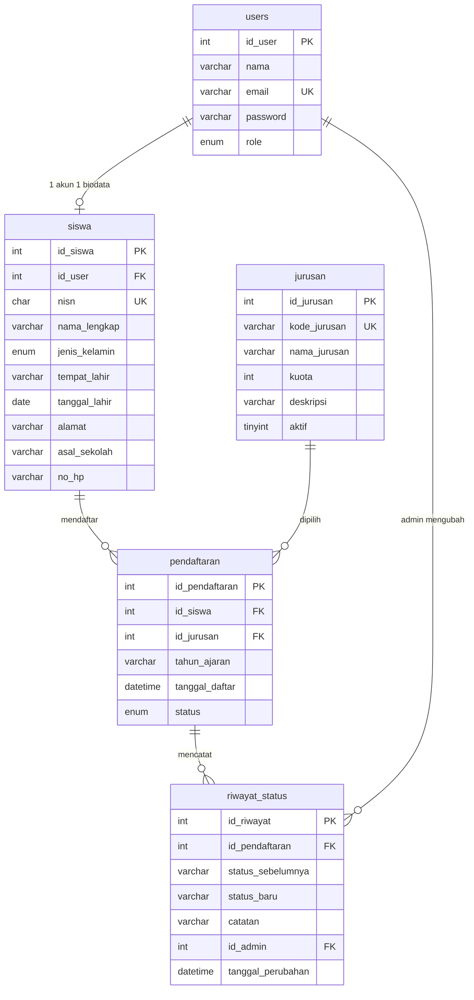

- Jika akun siswa dihapus, biodata, pendaftaran, dan riwayatnya ikut terhapus (`ON DELETE CASCADE`).
- Jurusan yang sudah dipilih pendaftar tidak bisa dihapus (`ON DELETE RESTRICT`). Jurusan seperti ini cukup dinonaktifkan.
- `UNIQUE (id_siswa, tahun_ajaran)` menjaga agar satu siswa hanya punya satu pendaftaran per tahun ajaran.

## Alur dan Aturan

1. Calon siswa melakukan registrasi. Email dan NISN harus unik, NISN 10 digit, dan password minimal 8 karakter yang di-hash dengan `password_hash`.
2. Setelah login, siswa melengkapi biodata. Halaman pendaftaran baru bisa dibuka setelah biodata lengkap.
3. Siswa memilih jurusan lalu mengirim pendaftaran. Nomor pendaftaran berformat `PPDB-2026-0001`. Jurusan yang nonaktif tidak muncul, dan jurusan yang kuotanya penuh tidak bisa dipilih.
4. Admin memeriksa pendaftaran dan mengubah status menjadi **Diverifikasi** atau **Ditolak**. Catatan wajib diisi jika status Ditolak.
5. Jika pendaftaran ditolak, siswa bisa memperbaiki biodata atau jurusan, dan statusnya kembali menjadi **Menunggu**. Setelah **Diverifikasi**, data siswa terkunci.
6. Setiap perubahan status dicatat di tabel `riwayat_status`.

Keamanan yang diterapkan: PDO prepared statement, `password_hash`/`password_verify`, `htmlspecialchars` saat menampilkan data, validasi di sisi server, serta cek session dan role di setiap halaman siswa/admin.

## Screenshot

| Halaman Utama | Registrasi | Login |
|---|---|---|
| 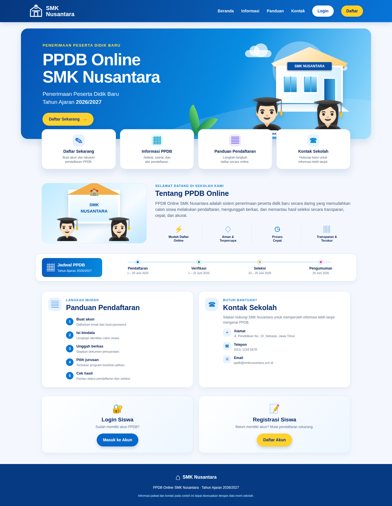 | 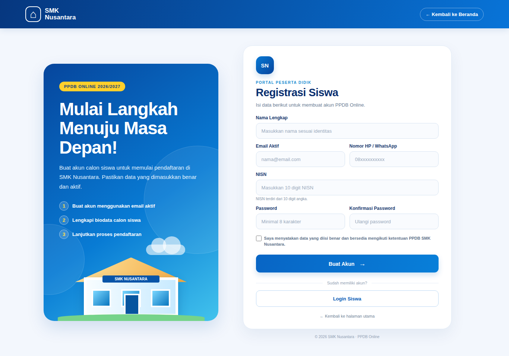 | 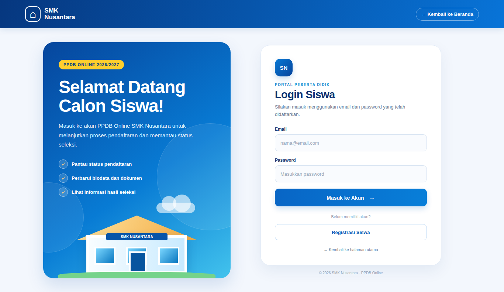 |

| Dashboard Siswa | Biodata | Pendaftaran |
|---|---|---|
| 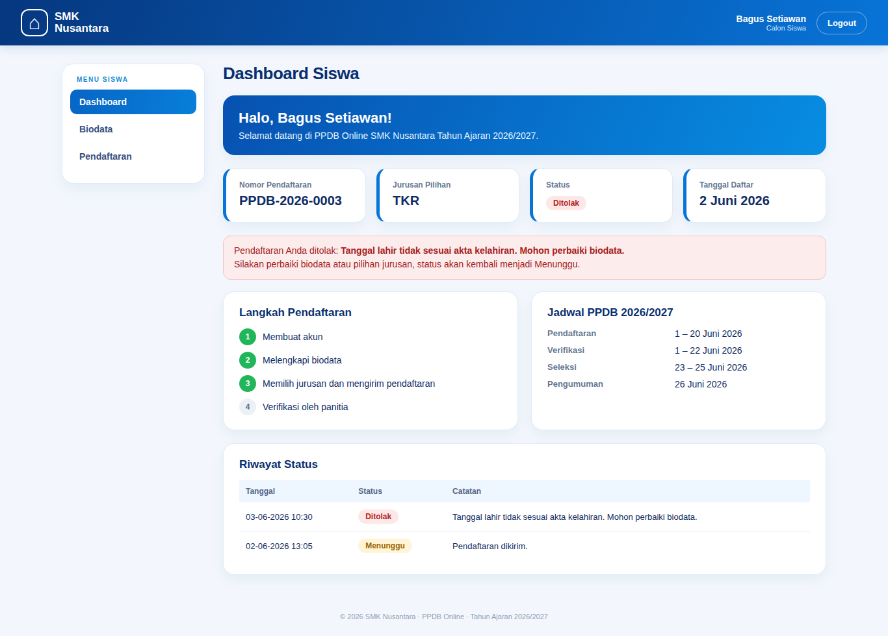 | 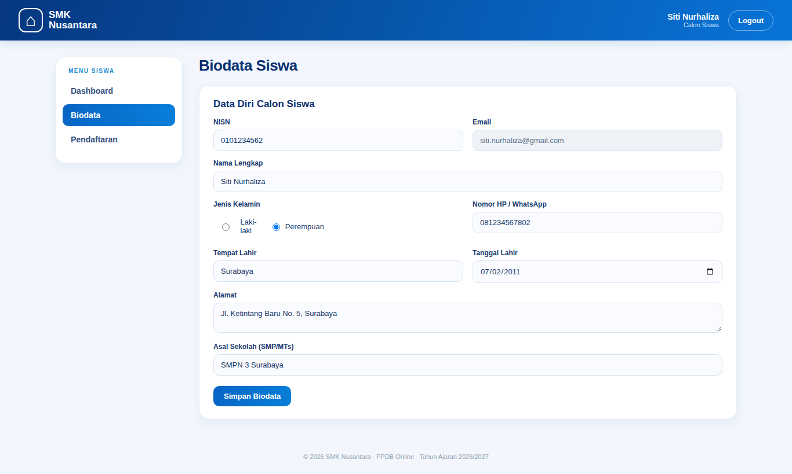 | 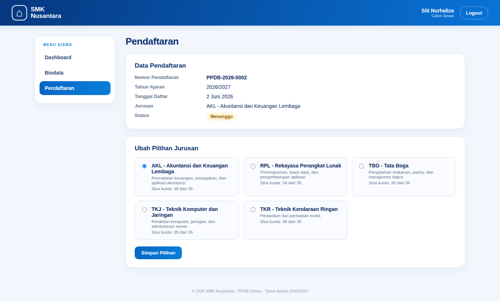 |

| Dashboard Admin | Data Siswa | Data Jurusan |
|---|---|---|
| 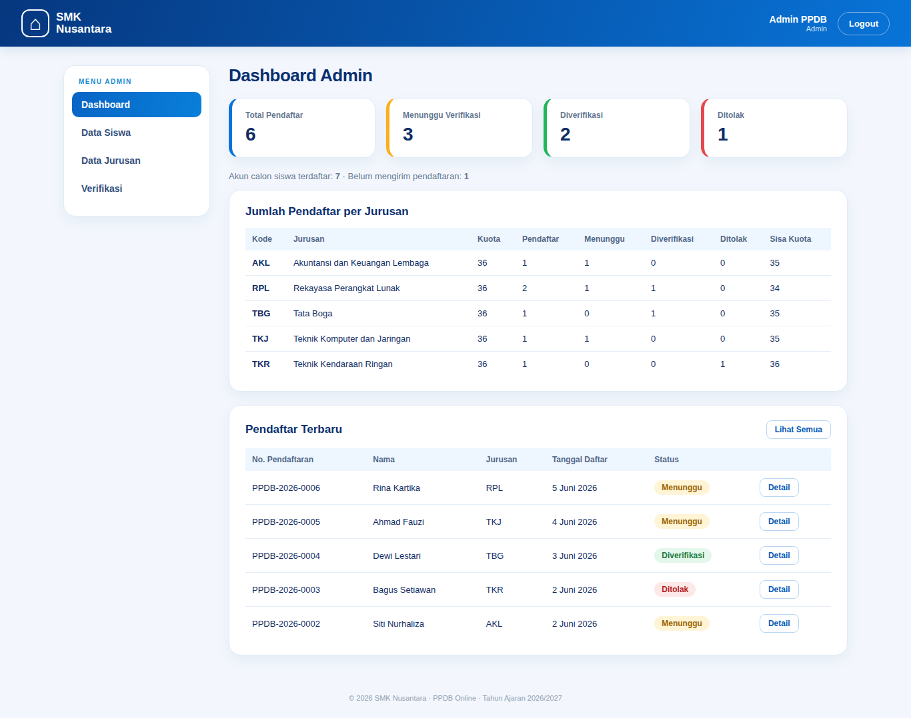 | 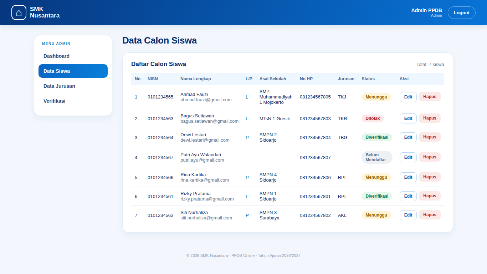 | 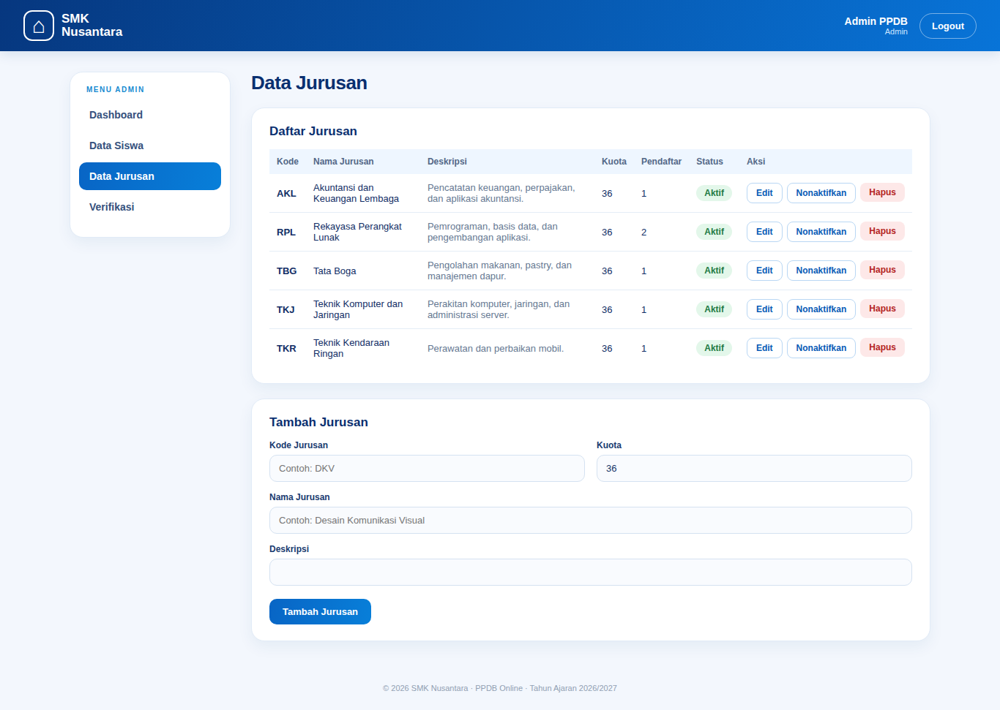 |

| Verifikasi | Periksa Pendaftaran |
|---|---|
| 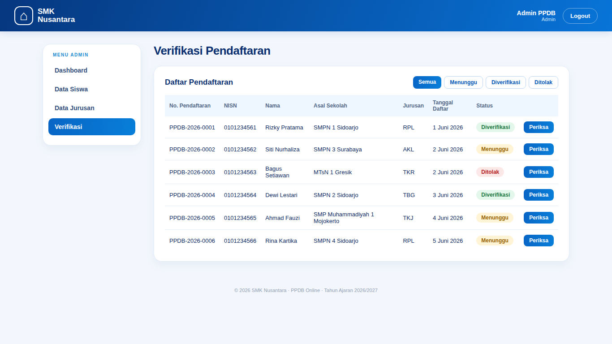 | 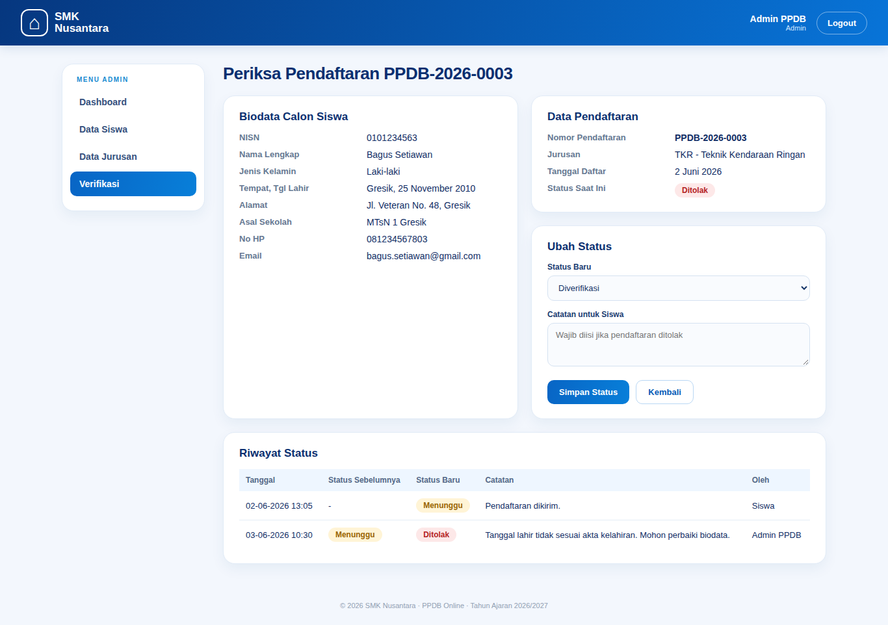 |

## Catatan

- Tampilan dibuat untuk desktop.
- Aplikasi ini memakai PHP dan MySQL, jadi tidak bisa dibuka lewat GitHub Pages. Jalankan di server lokal seperti XAMPP.
- Fitur Tahap 2 di PRD belum dibuat: upload berkas, seleksi dan status Diterima, pengumuman, serta laporan/ekspor. Teks "unggah berkas" di halaman utama berasal dari desain dosen dan belum ada fiturnya.
