# PPDB Online SMK Nusantara: Upload Pas Foto (PHP & MySQL)

Tugas ini dikerjakan dari materi [Membuat Upload Pas Foto Pelengkap Pendaftaran](https://fajarbaskoro.blogspot.com/2022/11/membuat-upload-pas-foto-pelengkap.html). Aplikasinya melanjutkan [task-meeting-11](../task-meeting-11/) (PPDB Online SMK Nusantara, MVP Tahap 1). Yang ditambahkan adalah fitur **upload pas foto 3x4** di form biodata calon siswa. File foto disimpan di folder `uploads/foto/`, dan nama filenya disimpan di kolom `foto` pada tabel `siswa`.

Teknologi yang dipakai adalah PHP (PDO prepared statement) dan MySQL. Tampilan halaman utama, login, dan registrasi memakai HTML/CSS contoh dari dosen. Halaman dashboard memakai CSS sendiri dengan warna yang sama. Tidak ada framework atau package tambahan.

## Fitur Upload Pas Foto

- Input pas foto ada di form biodata. Form ini dipakai di halaman **Biodata** (siswa) dan **Edit Data Siswa** (admin), dengan pratinjau foto ukuran 3x4.
- Pas foto **wajib**. Biodata baru dianggap lengkap jika pas foto sudah diupload, jadi siswa belum bisa memilih jurusan sebelum mengupload foto.
- File yang diterima hanya **JPG/JPEG/PNG** dengan ukuran **maksimal 1 MB**. Isi file diperiksa dengan `getimagesize()`, jadi file yang hanya diganti ekstensinya ditolak.
- File disimpan dengan nama baru `foto-<id_siswa>-<waktu>.jpg/png`, sehingga nama file antar siswa tidak bentrok.
- Jika foto diganti, file foto lama dihapus dari folder. Jika admin menghapus data siswa, file fotonya juga ikut dihapus.
- Jika siswa sudah punya foto dan tidak memilih file baru, foto lama tetap dipakai. Admin boleh mengganti foto, tetapi tidak wajib mengupload.
- Jika upload gagal, pesan error tampil dan isian biodata lain tidak hilang.
- Setelah pendaftaran **Diverifikasi**, pas foto ikut terkunci. Jika pendaftaran **Ditolak** lalu siswa mengganti foto, status kembali menjadi **Menunggu**.
- Pas foto tampil di halaman biodata, dashboard siswa, edit siswa (admin), dan Periksa Pendaftaran (admin).

## Struktur File

```
database.sql                  Script database db_ppdb_smk: 5 tabel + data contoh (dengan kolom foto)
index.php                     Halaman utama (desain dari dosen)
config/database.php           Koneksi PDO dan tahun ajaran
includes/
  fungsi.php                  Session, fungsi bantu, validasi biodata, upload pas foto, cek login & role
  header.php, footer.php      Layout dashboard (header + menu samping)
  form-biodata.php            Isian form biodata + input pas foto (dipakai siswa dan admin)
auth/
  login.php                   Login, diarahkan ke dashboard sesuai role
  register.php                Registrasi akun calon siswa
  logout.php                  Keluar dari akun
siswa/
  dashboard.php               Pas foto, nomor pendaftaran, jurusan, status, catatan, riwayat
  biodata.php                 Lihat dan ubah biodata, upload pas foto
  pendaftaran.php             Pilih jurusan dan kirim pendaftaran
admin/
  dashboard.php               Statistik pendaftar per status dan per jurusan
  siswa.php                   Daftar calon siswa + hapus (file foto ikut dihapus)
  siswa-edit.php              Edit biodata dan ganti pas foto calon siswa
  jurusan.php                 CRUD jurusan + aktif/nonaktif
  verifikasi.php              Daftar pendaftaran + filter status
  verifikasi-detail.php       Periksa data dan pas foto, ubah status, beri catatan
assets/css/
  styles.css, auth.css        CSS dari dosen (auth.css ditambah gaya pesan)
  dashboard.css               CSS halaman dashboard (termasuk kotak pas foto 3x4)
uploads/foto/                 Tempat file pas foto (berisi pas foto contoh)
screenshots/                  Screenshot hasil akhir (desktop)
```

## Cara Menjalankan

1. Jalankan Apache dan MySQL di XAMPP.
2. Salin folder `task-meeting-12` ke `htdocs`.
3. Buka phpMyAdmin, lalu import file `database.sql`. Jika database `db_ppdb_smk` dari task-meeting-11 sudah ada, hapus dulu database tersebut karena struktur tabel `siswa` berubah.
4. Jika user/password MySQL berbeda dari `root` tanpa password, ubah di `config/database.php`.
5. Buka `http://localhost/task-meeting-12/` di browser.

## Akun Contoh

Semua akun contoh memakai password **`ppdb2026`**.

| Role | Email | Keterangan |
|---|---|---|
| Admin | admin@smknusantara.sch.id | Panitia PPDB |
| Siswa | rizky.pratama@gmail.com | Diverifikasi (RPL), biodata dan foto terkunci |
| Siswa | siti.nurhaliza@gmail.com | Menunggu (AKL), bisa mengganti foto |
| Siswa | bagus.setiawan@gmail.com | Ditolak (TKR), ada catatan perbaikan |
| Siswa | putri.ayu@gmail.com | Biodata dan pas foto belum lengkap, belum mendaftar |

Pas foto data contoh berupa gambar siluet, bukan foto orang sungguhan. Akun admin hanya ada dari `database.sql`. Halaman registrasi selalu membuat akun dengan role siswa.

## Desain Database (ERD)

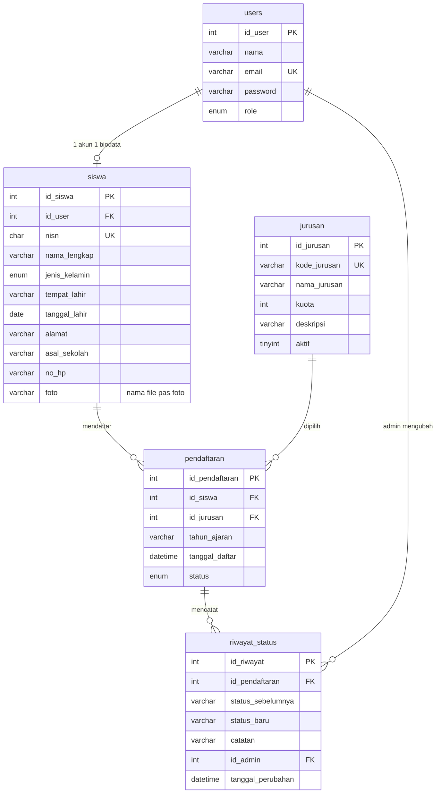

- Kolom `siswa.foto` hanya berisi nama file, misalnya `foto-1-1780275900.jpg`. File gambarnya ada di `uploads/foto/`. Nilainya `NULL` jika siswa belum mengupload foto.
- Jika akun siswa dihapus, biodata, pendaftaran, dan riwayatnya ikut terhapus (`ON DELETE CASCADE`).
- Jurusan yang sudah dipilih pendaftar tidak bisa dihapus (`ON DELETE RESTRICT`). Jurusan seperti ini cukup dinonaktifkan.
- `UNIQUE (id_siswa, tahun_ajaran)` menjaga agar satu siswa hanya punya satu pendaftaran per tahun ajaran.

## Alur dan Aturan

1. Calon siswa melakukan registrasi. Email dan NISN harus unik, NISN 10 digit, dan password minimal 8 karakter yang di-hash dengan `password_hash`.
2. Setelah login, siswa melengkapi biodata dan mengupload pas foto 3x4. Halaman pendaftaran baru bisa dibuka setelah biodata dan pas foto lengkap.
3. Siswa memilih jurusan lalu mengirim pendaftaran. Nomor pendaftaran berformat `PPDB-2026-0001`. Jurusan yang nonaktif tidak muncul, dan jurusan yang kuotanya penuh tidak bisa dipilih.
4. Admin memeriksa biodata dan pas foto, lalu mengubah status menjadi **Diverifikasi** atau **Ditolak**. Catatan wajib diisi jika status Ditolak.
5. Jika pendaftaran ditolak, siswa bisa memperbaiki biodata, pas foto, atau jurusan, dan statusnya kembali menjadi **Menunggu**. Setelah **Diverifikasi**, data siswa terkunci.
6. Setiap perubahan status dicatat di tabel `riwayat_status`.

Keamanan yang diterapkan: PDO prepared statement, `password_hash`/`password_verify`, `htmlspecialchars` saat menampilkan data, validasi di sisi server (termasuk pemeriksaan isi file gambar), nama file upload dibuat oleh server, serta cek session dan role di setiap halaman siswa/admin.

## Screenshot

| Halaman Utama | Registrasi | Login |
|---|---|---|
| 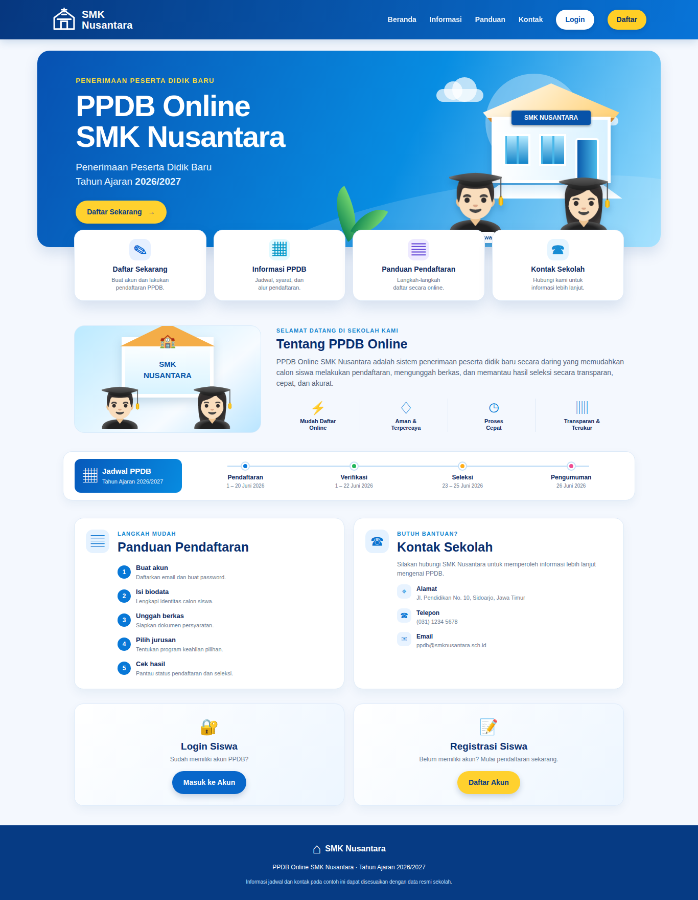 | 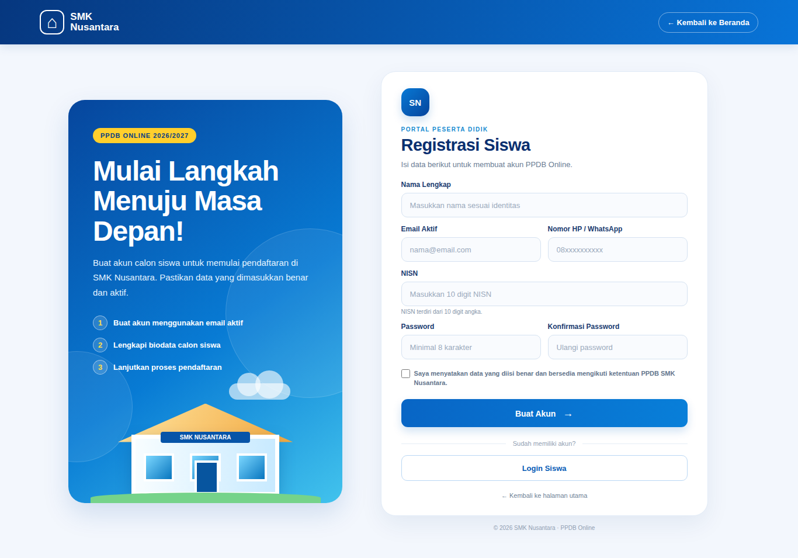 | 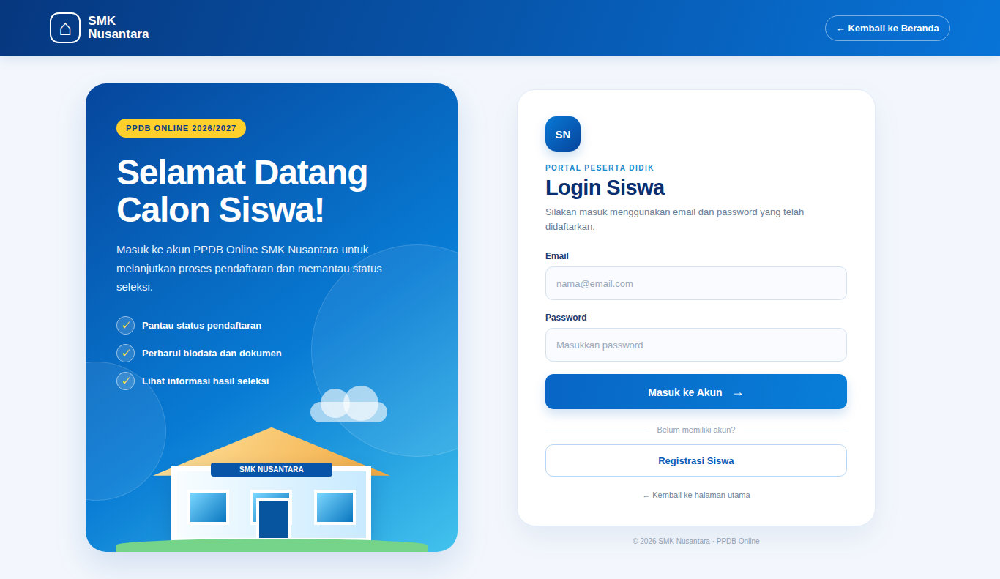 |

| Dashboard Siswa | Biodata dan Pas Foto | Validasi Pas Foto |
|---|---|---|
| 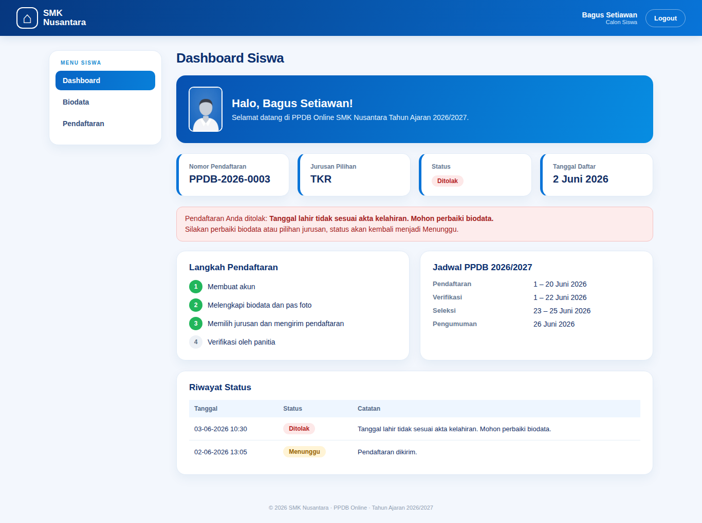 | 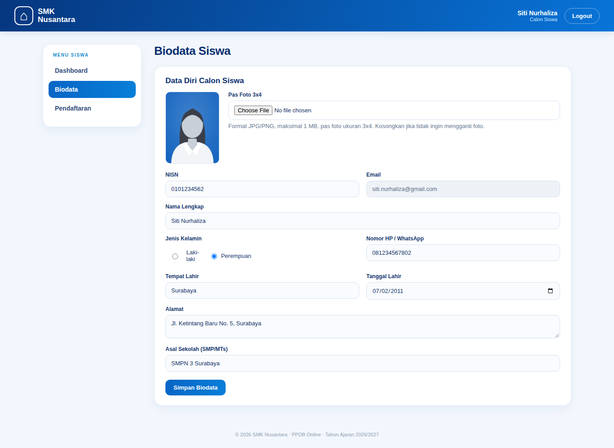 | 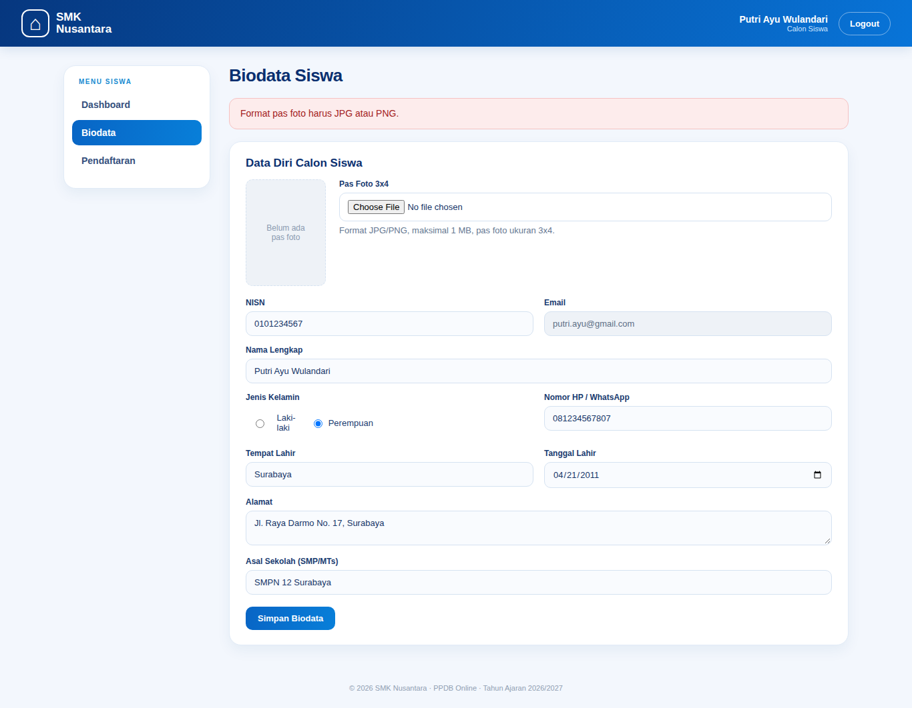 |

| Pendaftaran | Dashboard Admin | Data Siswa |
|---|---|---|
| 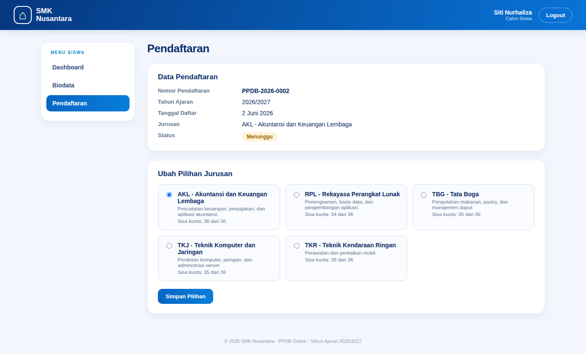 | 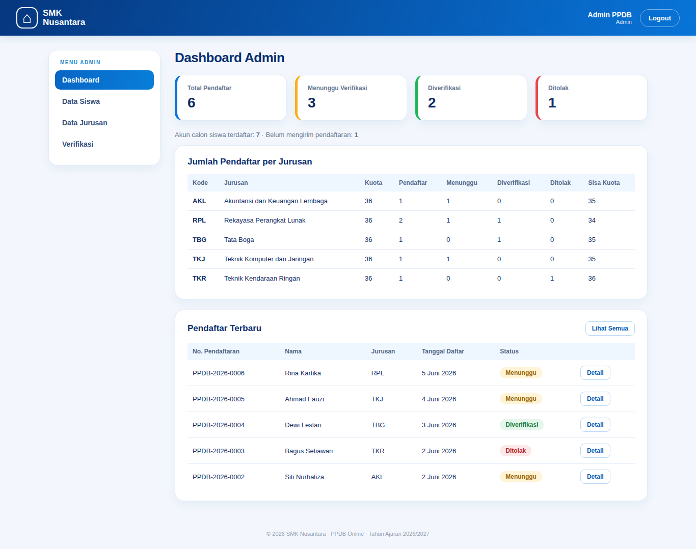 | 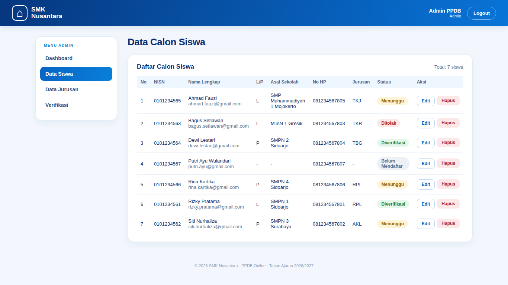 |

| Data Jurusan | Verifikasi | Periksa Pendaftaran |
|---|---|---|
| 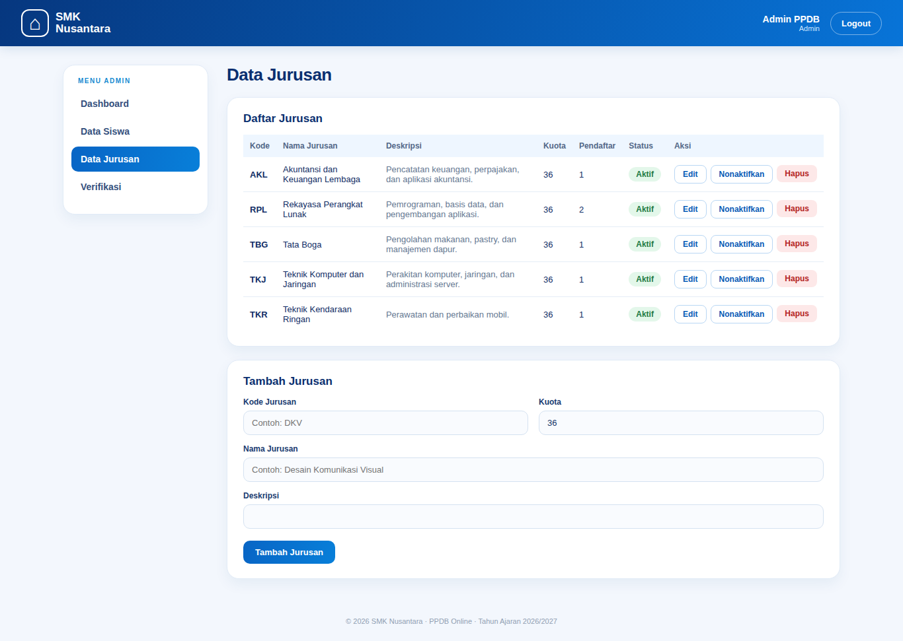 | 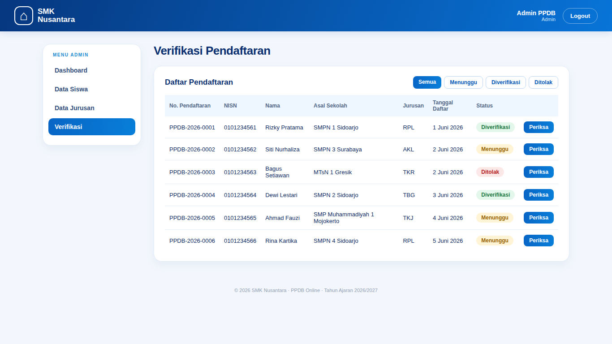 | 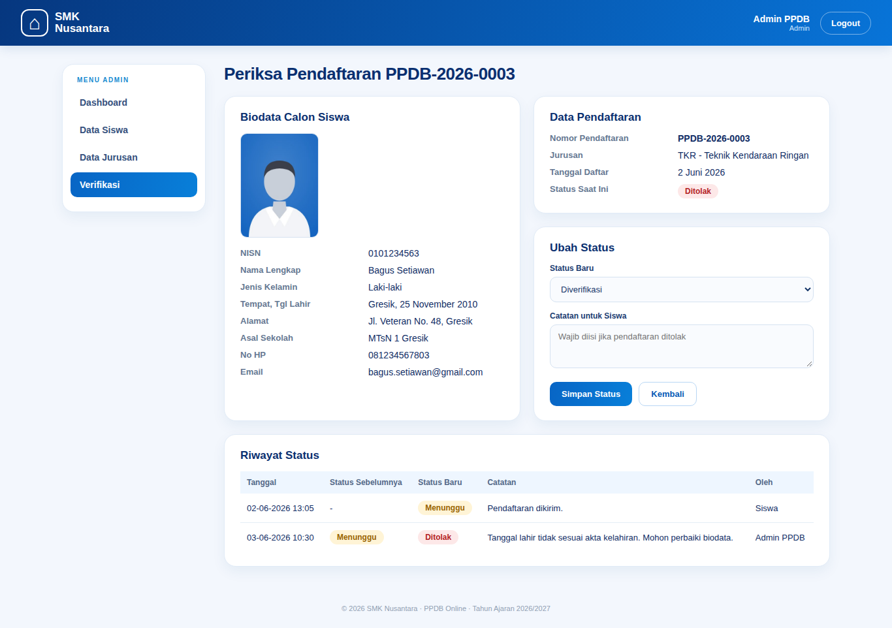 |

## Catatan

- Tampilan dibuat untuk desktop.
- Aplikasi ini memakai PHP dan MySQL, jadi tidak bisa dibuka lewat GitHub Pages. Jalankan di server lokal seperti XAMPP.
- Fitur Tahap 2 di PRD yang belum dibuat: upload berkas lain selain pas foto, seleksi dan status Diterima, pengumuman, serta laporan/ekspor.
