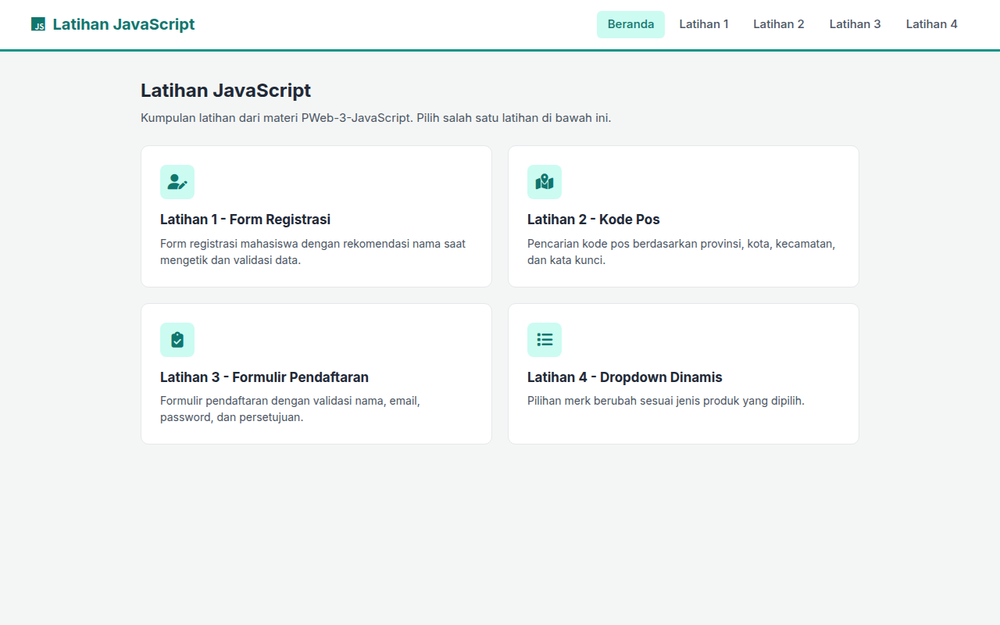
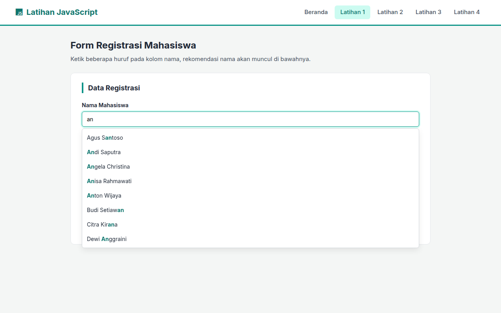
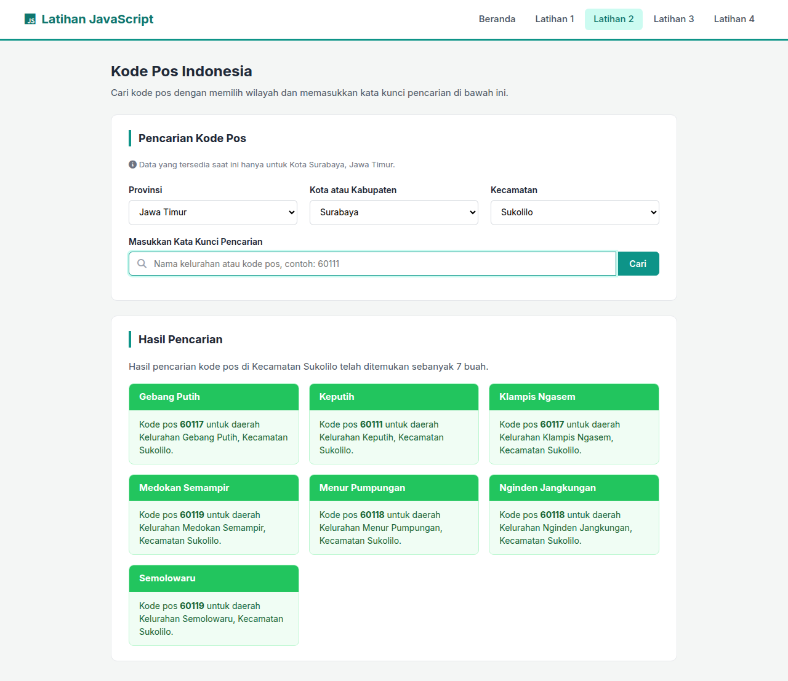
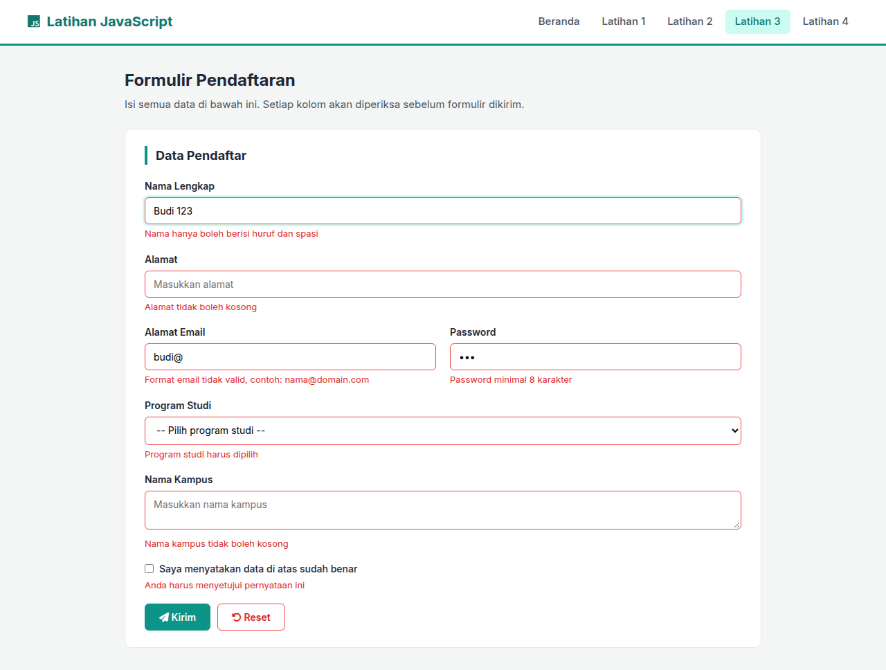
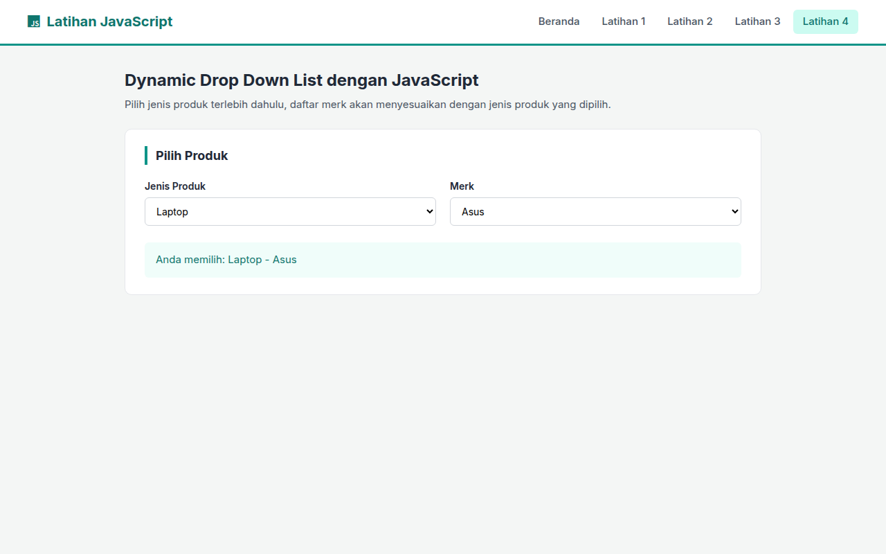

# Latihan JavaScript

Empat latihan JavaScript dari materi [PWeb-3-JavaScript](https://fajarbaskoro.blogspot.com/2017/03/pweb-3-javascript.html), dibuat menggunakan HTML, CSS, dan JavaScript tanpa library.

- Website: https://jojoevan.github.io/web-programming/task-meeting-6/

## Struktur File

```
index.html        Halaman Beranda: menu ke empat latihan
latihan-1.html    Latihan 1: form registrasi dengan rekomendasi nama dan validasi
latihan-1.js
latihan-2.html    Latihan 2: pencarian kode pos berdasarkan wilayah dan kata kunci
latihan-2.js
latihan-3.html    Latihan 3: formulir pendaftaran dengan validasi
latihan-3.js
latihan-4.html    Latihan 4: dropdown dinamis jenis produk dan merk
latihan-4.js
style.css         CSS untuk semua halaman
screenshots/      Screenshot hasil akhir (desktop)
```

## Screenshot

| Beranda | Latihan 1 |
|---|---|
|  |  |

| Latihan 2 | Latihan 3 |
|---|---|
|  |  |

| Latihan 4 |
|---|
|  |

## Catatan

- Daftar nama mahasiswa, mata kuliah, dan dosen pada Latihan 1 adalah data contoh.
- Data kode pos pada Latihan 2 hanya mencakup Kota Surabaya (31 kecamatan, 153 kelurahan), diambil dari [sooluh/kodepos](https://github.com/sooluh/kodepos).
- Data yang dikirim lewat form tidak disimpan, hanya ditampilkan sebagai ringkasan.
- Ikon menggunakan Font Awesome dan font menggunakan Inter dari Google Fonts.
