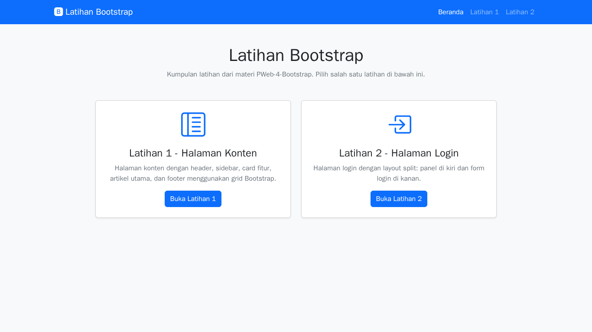
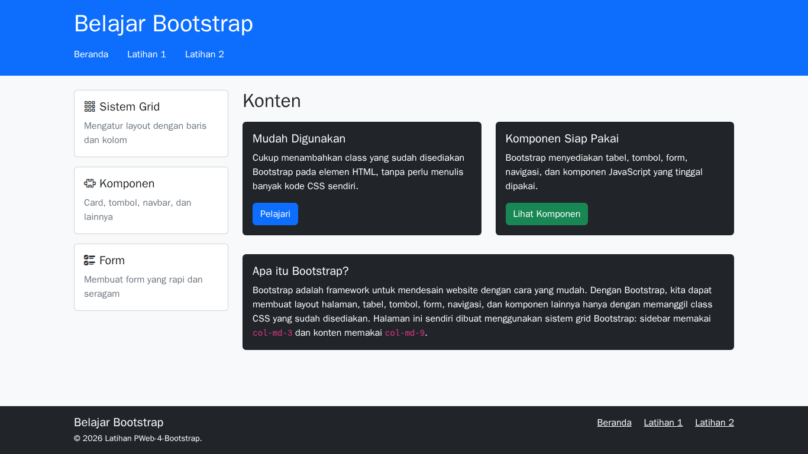
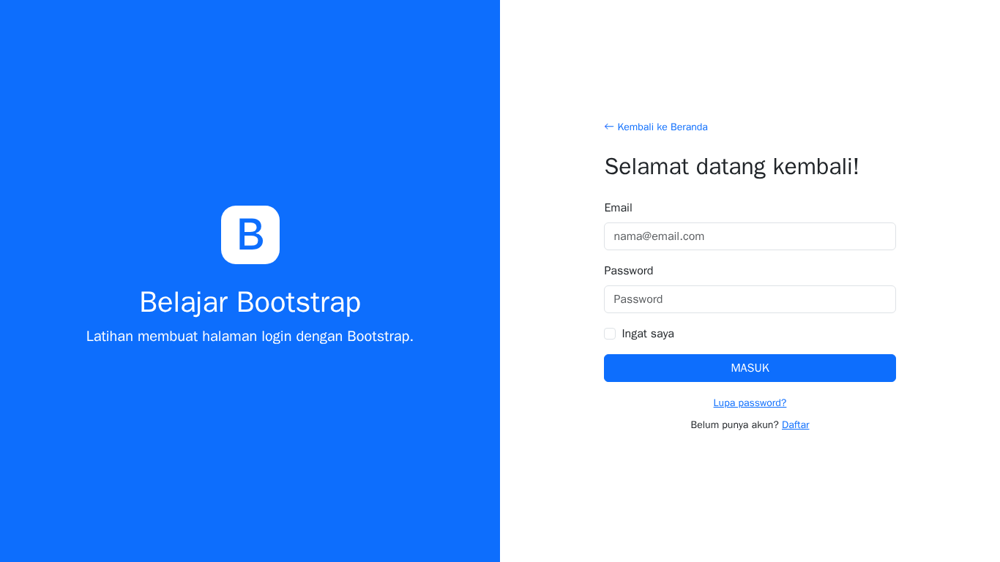

# Latihan Bootstrap

Dua latihan Bootstrap dari materi [PWeb-4-Bootstrap](https://fajarbaskoro.blogspot.com/2017/03/pweb-4-bootstrap.html), dibuat menggunakan HTML dan Bootstrap 5 tanpa CSS dan JavaScript buatan sendiri.

- Website: https://jojoevan.github.io/web-programming/task-meeting-7/

## Struktur File

```
index.html        Halaman Beranda: menu ke dua latihan
latihan-1.html    Latihan 1: halaman konten dengan header, sidebar, card fitur, artikel utama, dan footer
latihan-2.html    Latihan 2: halaman login dengan layout split
screenshots/      Screenshot hasil akhir (desktop)
```

## Screenshot

| Beranda | Latihan 1 |
|---|---|
|  |  |

| Latihan 2 |
|---|
|  |

## Catatan

- Tampilan dibuat untuk desktop.
- Form login hanya tampilan, data tidak dikirim ke mana pun.
- Bootstrap dan ikon Bootstrap Icons dimuat dari CDN jsDelivr.
