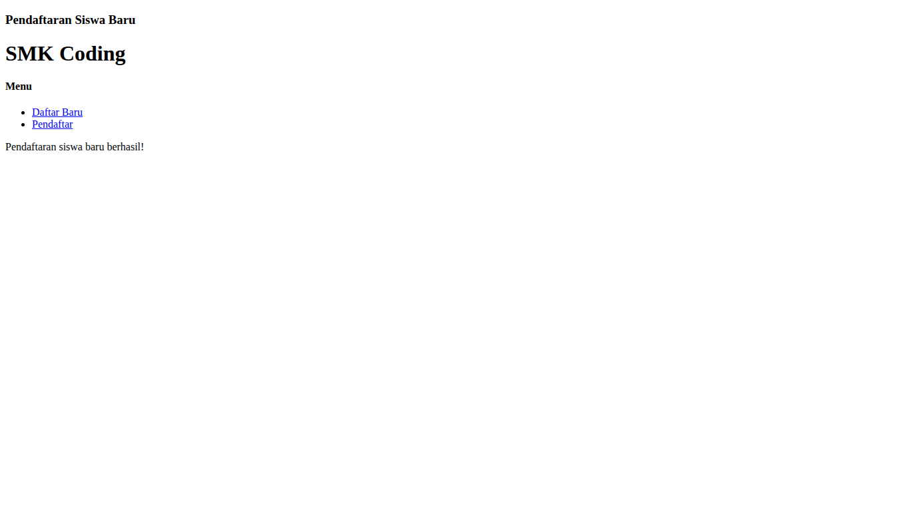
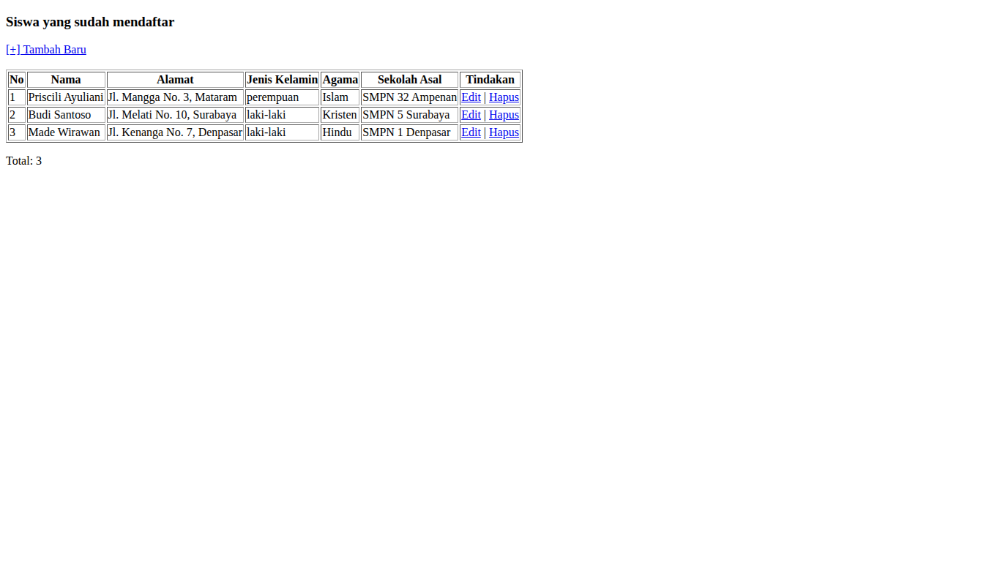
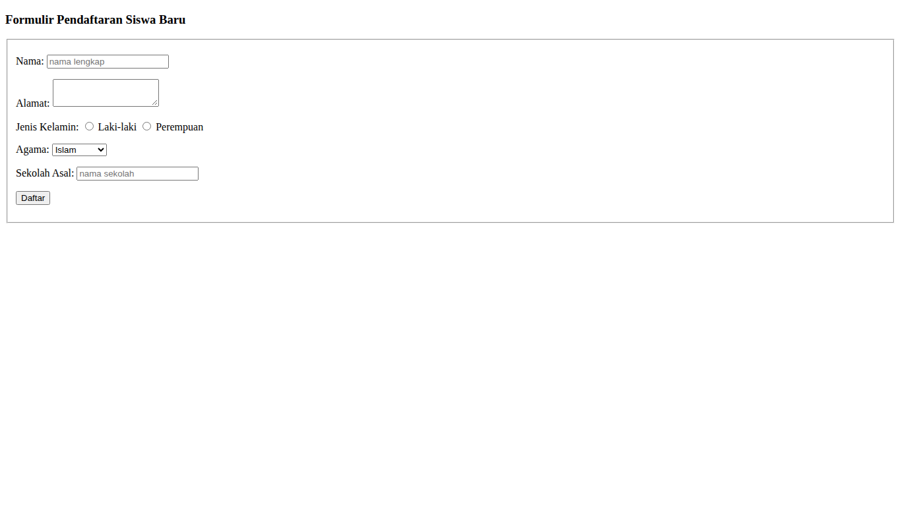
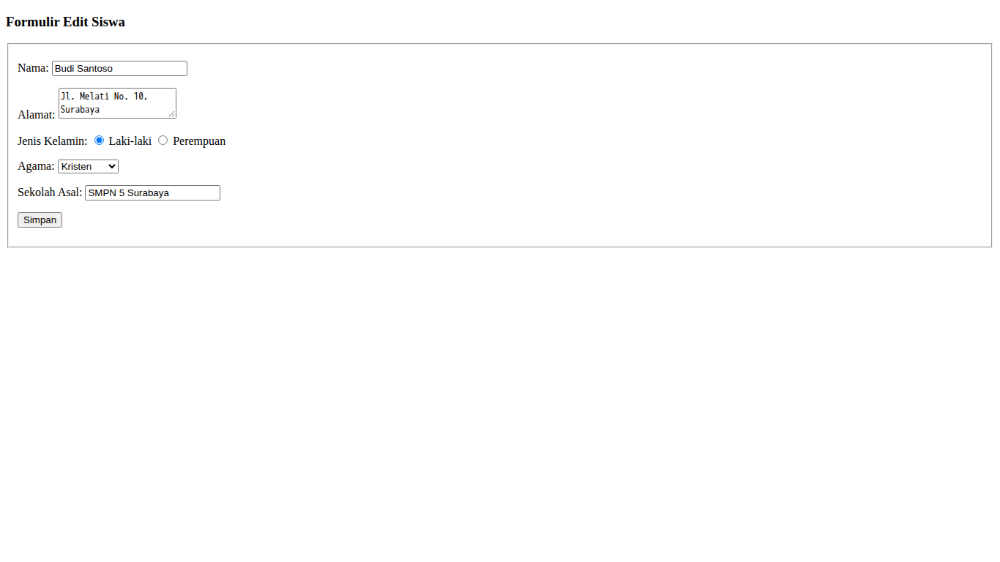

# Pendaftaran Siswa Baru (PHP & MySQL)

Aplikasi CRUD sederhana untuk mendaftarkan calon siswa baru, mengikuti tutorial [Tutorial PHP & MySQL: Membuat Aplikasi CRUD untuk Pendaftaran Siswa Baru](https://www.petanikode.com/tutorial-php-mysql/) dari Petani Kode. Dibuat dengan PHP (mysqli prosedural) dan MySQL. Tampilannya HTML biasa tanpa CSS, sama seperti contoh di tutorial.

## Struktur File

```
database.sql             Script pembuatan database pendaftaran_siswa, tabel calon_siswa, dan data contoh
config.php               Koneksi ke database
index.php                Halaman utama: menu dan pesan status pendaftaran
form-daftar.php          Formulir pendaftaran siswa baru
proses-pendaftaran.php   Menyimpan data pendaftaran (INSERT)
list-siswa.php           Tabel daftar pendaftar (SELECT)
form-edit.php            Formulir edit data siswa
proses-edit.php          Menyimpan perubahan data (UPDATE)
hapus.php                Menghapus data siswa (DELETE)
screenshots/             Screenshot hasil akhir (desktop)
```

## Cara Menjalankan

1. Jalankan Apache dan MySQL di XAMPP.
2. Salin folder `task-meeting-9` ke `htdocs`.
3. Buka phpMyAdmin, lalu import file `database.sql`.
4. Jika user/password MySQL berbeda dari `root` tanpa password, ubah di `config.php`.
5. Buka `http://localhost/task-meeting-9/` di browser.

## Screenshot

| Beranda | Daftar Pendaftar |
|---|---|
|  |  |

| Formulir Daftar | Formulir Edit |
|---|---|
|  |  |

## Catatan

- Tampilan dibuat untuk desktop.
- Aplikasi ini memakai PHP dan MySQL, jadi tidak bisa dibuka lewat GitHub Pages. Jalankan di server lokal seperti XAMPP.
- Tambahan dari tutorial: input di-escape dengan `mysqli_real_escape_string`, id diubah ke angka, output memakai `htmlspecialchars`, dan ada konfirmasi sebelum menghapus.
